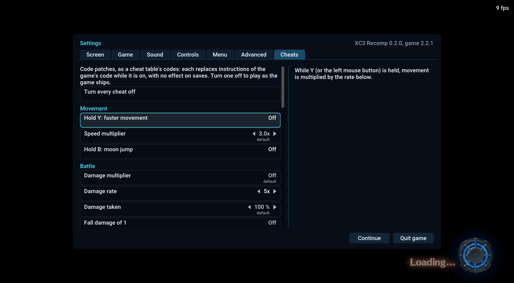

# XC3 Recomp

> [!NOTE]
> **This is a fork of [jmars125/xc3-recomp](https://github.com/jmars125/xc3-recomp).** It adds a Cheats tab to the
> settings menu: 28 rows that switch code patches while the game runs, taken from the Xenoblade Chronicles 3 2.2.0
> cheat table of Sodamyte and Eiffel2018. The rest is upstream's work, unchanged. Upstream's installers do not have
> the tab; this fork builds its own package and publishes it on [Releases](../../releases/latest).

**XC3 Recomp** is a static recompilation of *Xenoblade Chronicles 3* (Nintendo Switch, 2022) into a native Windows x86-64 application ([docs/architecture.md](docs/architecture.md)). It is a fork of [XCX Recomp](https://github.com/jmars125/xcx-recomp), itself a fork of [TotK Recomp](https://github.com/valentderah/totk-pc-recomp) by Valiantsin Dzerakh.

> [!IMPORTANT]
> **No game files are included.** You need your own legally obtained copy of *Xenoblade Chronicles 3*, dumped from your own console: the base game and the 2.2.1 update (the add-on content is optional). Instructions for obtaining those files will not be provided.
>
> The game is built from your files on your machine, so the result contains the game. It is for your own use. Do not share it.

## Cheats in this fork

F1 → *Cheats* has 28 cheats in five groups, and one takes effect the moment it is switched: no restart, and no save is
touched. The first row of the page turns every cheat off at once.

- **Movement** — hold Y: movement `speed_x` times as fast (1x to 10x); hold B: a fall turns upward instead of landing.
- **Battle** — damage dealt `cheat_dmg_x` times; the share of damage taken, 100 % to 0 %; fall damage 1; chain attack
  gauge; arts gauge, the Talent Art's and the three party arts'; no art cooldown.
- **Progress** — XP `cheat_exp_x` times, SP 5 times, affinity 5 times, class rank and class icon fill `_x` times,
  ascension, every class the party has met unlocked at the next battle, Soul Hack, the class icon fix, ignore level
  difference.
- **Items** — money never drops when something is bought, Nopon coins count 999, item gain 5 times, meals last
  `cheat_meal_x` times as long, pickup distance `cheat_pickup_x` times, quests need no items, any level at a rest spot.
- **World** — whole map open, unique monsters alive again, every art and skill.

Every row is an `xc3.ini` key as well, so a choice survives between runs and the environment can set it from outside.

**Why it is not a cheat table.** The game is a static recompilation, so the addresses a table holds are gone by the time
it runs and there is no instruction word to write. The cheats are part of the build instead: `recomp/patches-upd.txt`
names the instruction to replace, and the generator emits both paths, the replacement while the row is on and the
original while it is off, which is what lets a row switch at run time. [docs/cheats.md](docs/cheats.md) has the
mechanism, the limits of a site and the steps for adding a row.

**Where the codes come from.** The 2.2.0 table of Sodamyte and Eiffel2018 for Ryujinx, build id `82D187FE9EF9BE92`,
the same `main` this tree lifts. No code from that table is copied: each site re-derives its hook as a build-time
patch. Four of its rows are not ported (Ouroboros heat, quest locking, Art of Flow, Colony Iota), and none of them has
a row in the menu, so nothing is offered that does not work.

A game update moves every site. `tools/cheatkit/update.py --install` relocates them by signature, regenerates and
rebuilds ([tools/cheatkit/README.md](tools/cheatkit/README.md)); a site whose original instruction no longer matches
stops the build instead of patching the wrong one.

## Status

Playable from New Game through the story, cutscenes and battles on Windows, with sound, text and the menu. 60 fps by
default; 30 to 360 in the settings, with game speed kept right at any rate.

Known issues:

- Some busy areas and cutscenes drop to around 40 fps on any GPU: the game's own CPU work bounds them. Frame generation
  helps there.
- The first visit to a place can stutter briefly while its shaders build; later visits do not.
- Linux and the Steam Deck: the setup builds and installs, but play is not yet tested on a real GPU.

Report problems as issues, following [CONTRIBUTING.md](CONTRIBUTING.md).

## Features

- Native code, not emulation
- Update 2.2.1 and all four add-on content packs, including Future Redeemed
- XC3-Setup: builds the game from your own NSP files and `prod.keys`
- In-game settings menu (F1) and performance overlay (F10)
- Cheats: the settings menu's Cheats tab switches a set of code patches while the game runs, without a restart and
  without touching a save ([docs/cheats.md](docs/cheats.md))
- Keyboard, mouse and gamepad, with Xbox or PlayStation button prompts
- 60 fps and above (`fps_limit` up to 360 or the display's rate)
- Any game resolution and aspect ratio, including ultrawide 21:9 and 32:9 (`output_res`, `ui_fit`)
- Upscaling and anti-aliasing (`upscaler`): NVIDIA DLSS and DLAA on RTX cards, AMD FSR 3 on any GPU, each in place of
  the game's own temporal reconstruction, with `render_scale` setting the share of the resolution the 3D scene draws
  in; FSR 1 for a window larger than the game resolution
- Frame generation (`frame_gen`; takes a restart): NVIDIA DLSS Frame Generation on RTX 40 and 50 cards, AMD FSR 3 frame
  generation on any GPU, a generated frame between every two the game draws; DLSS Multi Frame Generation
  (`frame_gen_multi`, 3x to 6x) on RTX 50 cards. It needs a temporal upscaler (`fsr3`,
  `dlss` or `dlaa`). The frame limit counts the frames on screen, so 120 draws 60 and shows 120; the overlay counts
  the frames on screen too. The game's interface is kept out of the generated frames
- DLSS model choice (`dlss_preset`) and NVIDIA Reflex low latency (`reflex`) with DLSS or DLAA
- Dynamic resolution (`dynamic_res`): the game's own, the 3D scene drawn smaller while the GPU cannot keep up with the
  frame limit
- HDR10 output (`hdr`; Windows' HDR on): the scene's highlights expanded towards the display's peak, the interface
  kept at its own brightness
- Variable refresh rate (`vrr`): for G-SYNC and FreeSync monitors, each frame shows when it is ready and the frame
  rate stays a little under the refresh rate (116 at 120 Hz), inside the monitor's range
- RomFS mods made for emulators: unpack a mod into a `mods` folder next to `xc3.exe`. Mods that need the Skyline
  plugin xc3-file-loader (text, fonts, models) work without it ([docs/mods.md](docs/mods.md))

Every setting is in the F1 menu and in `xc3.ini` ([xc3.ini.example](xc3.ini.example) lists every key). The setup puts
the NVIDIA (Streamline, DLSS) and AMD (FidelityFX) libraries next to `xc3.exe`.

## Planned

- Linux and the Steam Deck tested on real hardware

## Installing

Requirements: Windows 10 or later, an x86-64 CPU with SSE4.2 (AVX2 runs it a little faster; without it the setup compiles for older CPUs), a GPU with Vulkan 1.3 and `VK_EXT_external_memory_host`, about 36 GiB free during setup (20 GiB after). DLSS needs an NVIDIA RTX card; DLSS Frame Generation an RTX 40 or 50 card with hardware-accelerated GPU scheduling on.

1. Download `XC3-Setup-<version>-windows.zip` from [Releases](../../releases/latest) and unpack it.
2. Start `XC3-Setup.exe`. If SmartScreen warns about an unsigned app, choose *More info*, then *Run anyway*.
3. Pick your game files, the language and an install folder, and press *Start*. The setup builds the game once.
4. Play `xc3.exe` from the install folder.

To update, run a newer `XC3-Setup.exe` on the same folder; saves and settings are kept. Controls: [docs/controls.md](docs/controls.md).

## Credits

XC3 Recomp builds on the projects below. What was taken from each, with its license, is listed in [THIRD_PARTY_NOTICES.md](THIRD_PARTY_NOTICES.md).

- [XCX Recomp](https://github.com/jmars125/xcx-recomp), the project XC3 Recomp is forked from
- [TotK Recomp](https://github.com/valentderah/totk-pc-recomp) by Valiantsin Dzerakh, the project XC3 Recomp is forked from
- [LAS Recomp](https://github.com/peiikai/LASRecomp)
- [MacNativeGames](https://github.com/ly05010419/MacNativeGames)
- [d2r-mobile](https://github.com/jhaizhou-ops/d2r-mobile) and [nxnative](https://github.com/seedds/nxnative)
- [SavageWindRecomp](https://github.com/Revivedx/SavageWindRecomp)
- [Ryujinx](https://github.com/Ryujinx/Ryujinx)
- [deko3d](https://github.com/devkitPro/deko3d)
- [hactool](https://github.com/SciresM/hactool)
- [SDL 3](https://libsdl.org), [Dear ImGui](https://github.com/ocornut/imgui), [AMD FSR 1](https://github.com/GPUOpen-Effects/FidelityFX-FSR), [AMD FidelityFX SDK (FSR 3)](https://github.com/GPUOpen-LibrariesAndSDKs/FidelityFX-SDK), [NVIDIA Streamline (DLSS)](https://github.com/NVIDIA-RTX/Streamline), [Vulkan Memory Allocator](https://github.com/GPUOpen-LibrariesAndSDKs/VulkanMemoryAllocator), [libopus](https://opus-codec.org), [libvpx](https://chromium.googlesource.com/webm/libvpx), [Zstandard](https://github.com/facebook/zstd)
- The [60FPS mod for XC3 1.0.1](https://github.com/Fl4sh9174/Switch-Emulator-Ultrawide-FPS-Mods) by Fl4sh_ and StevensND
- The Xenoblade Chronicles 3 2.2.0 cheat table of Sodamyte and Eiffel2018, whose hooks the Cheats tab re-derives as build-time patches
- [Switchbrew](https://switchbrew.org) and the Switch homebrew community

## License

The project's own code is under the [MIT License](LICENSE); third-party code keeps its own license ([THIRD_PARTY_NOTICES.md](THIRD_PARTY_NOTICES.md)). The license grants nothing for Nintendo's game.

XC3 Recomp is an independent, non-commercial fan project, not affiliated with or endorsed by Nintendo. *Xenoblade Chronicles 3* and *Nintendo Switch* are trademarks of Nintendo; Xenoblade Chronicles 3 is developed by Monolith Soft.

## Building from source

[docs/building.md](docs/building.md) lists the toolchain and the steps. Everything the build writes stays under `build\` and `generated\`, which git ignores; run `tools/check_content.py` before a commit. Testers: [docs/tester-guide.md](docs/tester-guide.md).

Most of the code and documentation is written by AI coding agents (Claude Code) under the maintainer's direction; the maintainer plays every build and decides what is merged. [AGENTS.md](AGENTS.md) holds the rules they work under.
